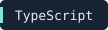

  <a href="https://josepereira.dev">Portfolio</a> ·
  <a href="mailto:jlpereira355@gmail.com">Email</a> ·
  <a href="https://www.linkedin.com/in/josepereirao">LinkedIn</a>

### Hello, I'm Jose

Software Engineer based in **Hamburg, Germany**, building web and mobile applications with a focus on thoughtful interfaces and dependable backend services.

- **Sixsense Labs · since 2024** — full-stack web and mobile development.
- **M.Sc. in Data Science** — University of Europe for Applied Sciences.
- From React interfaces to Node.js and Python services, AWS infrastructure and relational data.

### Stack

  
  
  
  
  
  
  

### Selected work

**01 / [FlowBoard](https://github.com/jlpereira8/flowboard)**  
Project management with Kanban boards, drag-and-drop workflows and relational data.  
`Next.js` `TypeScript` `Prisma` `PostgreSQL`  
[Live demo ↗](https://flowboard-dev-jl.vercel.app/) · [Case study](https://josepereira.dev/projects/flowboard)

**02 / [Ecommerce](https://github.com/jlpereira8/eCommerceApp)**  
A responsive storefront with product discovery, wishlists, cart, checkout and dark mode.  
[Live demo ↗](https://e-commerceapp-pi.vercel.app/) · [Case study](https://josepereira.dev/projects/ecommerce)

**03 / [Crypto Dashboard](https://github.com/jlpereira8/crypto-dashboard)**  
Cryptocurrency market analytics with CoinGecko data, interactive charts and an asset converter.  
`Next.js` `TanStack Query` `ApexCharts`  
[Live demo ↗](https://crypto-dashboard-eosin-phi.vercel.app/) · [Case study](https://josepereira.dev/projects/crypto-dashboard)

---

**Have something in mind? [Let's talk ↗](mailto:jlpereira355@gmail.com)**
